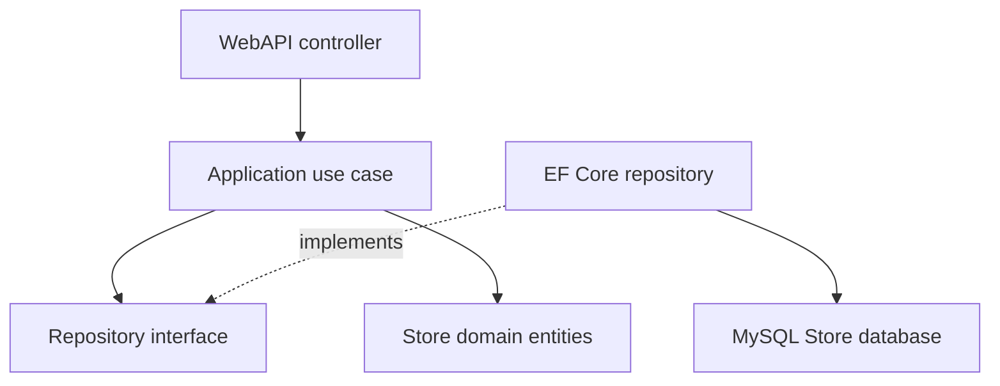

# SportWearShop Store API

An ASP.NET Core Web API for the Store module of SportWearShop. The current implementation includes the MySQL schema, application and presentation foundations, and a versioned, paginated Brand listing.

## Tech Stack

| Area | Technology |
| --- | --- |
| Web API | .NET 10, ASP.NET Core controllers, Asp.Versioning, Swashbuckle |
| Application | MediatR, FluentValidation, ErrorOr, Ardalis Specification |
| Persistence | EF Core 10, MySQL 8.4, `MySql.EntityFrameworkCore` |
| Architecture | Clean Architecture with use cases grouped by feature in Application |
| Tooling | Docker Compose, `Directory.Build.props`, `Directory.Packages.props` |
| Testing | xUnit and Coverlet |

## Project Scope

- **Implemented Store API:** View brands with pagination, search, active-status filtering, and sorting. The legacy Brand list remains available for existing callers.
- **Persistence foundation:** MySQL bootstrap scripts, EF model configurations, an initial migration and model snapshot, a generic repository, a Unit of Work, catalog builders, and an optional demo Brand seeder.
- **Web API foundation:** URL-based API versioning, Swagger and OpenAPI, centralized exception handling, Problem Details responses, and UTC JSON converters.
- **Schema groundwork:** The Store schema covers catalog, customers, addresses, ratings, carts, orders, payments, and inventory. These database tables are groundwork for future use cases. Brand listing is the Store business API documented here.

## Current API Endpoints

| Method | Route | Response |
| --- | --- | --- |
| GET | `/api/v1/brands` | Paginated Brand list with filter and sort options |
| GET | `/api/brands` | Legacy Brand list as a JSON array, with optional `isActive` filter |
| GET | `/weatherforecast` | Template endpoint for checking that the WebAPI starts |
| GET | `/swagger/index.html` | Swagger UI in Development |
| GET | `/swagger/v1/swagger.json` | OpenAPI document for API v1 in Development |
| GET | `/openapi/v1.json` | Compatibility URL for the same OpenAPI document in Development |

### View Brands

| Query parameter | Default | Description |
| --- | --- | --- |
| `pageNumber` | `1` | One-based page number |
| `pageSize` | `10` | Number of items per page, from 1 to 100 |
| `searchTerm` | — | Search Brand name or code by substring, up to 100 characters |
| `isActive` | — | Filter by active status when set to `true` or `false` |
| `sortBy` | `name` | Accepts `name`, `code`, or `createdAtUtc` |
| `sortDesc` | `false` | Set to `true` for descending order |

```http
GET /api/v1/brands?pageNumber=1&pageSize=10&sortBy=name&isActive=true
```

The response includes `items`, `pageNumber`, `pageSize`, `totalCount`, `totalPages`, `hasPreviousPage`, and `hasNextPage`. Each item contains `id`, `code`, `name`, and `isActive`. An empty result returns HTTP `200` with an empty `items` array. Invalid query values return HTTP `400` with validation details.

## Architecture



| Project | Responsibility |
| --- | --- |
| `SportWearShop.Domain` | Store entities, catalog enums, currency constants, and timestamp contracts and utilities |
| `SportWearShop.Application` | Use cases, request and response contracts, validators, specifications, pagination, and repository abstractions |
| `SportWearShop.Persistence` | `StoreDbContext`, entity mappings, repository and Unit of Work implementations, builders, migrations, and seeding |
| `SportWearShop.Infrastructure` | Project for external integrations |
| `SportWearShop.WebAPI` | Controllers, dependency registration, versioning, Swagger, JSON conversion, and HTTP error handling |

`ViewBrandsController` sends the request through MediatR. The handler validates it with FluentValidation and builds an Ardalis specification. The repository counts filtered rows before paging and projects just the requested page into response DTOs. Sorting uses Brand ID as a tie-breaker so duplicate sort values have a stable order.

## Project Structure

```text
Backend/
├── Directory.Build.props
├── Directory.Packages.props
├── SportWearShop.slnx
├── Identity/
├── Store/src/
│   ├── SportWearShop.Domain/
│   ├── SportWearShop.Application/
│   │   ├── Abstractions/DataAccess/
│   │   ├── Common/Validators/
│   │   ├── UseCases/Brands/ViewBrands/
│   │   └── Utilities/
│   ├── SportWearShop.Persistence/
│   │   ├── Builders/
│   │   ├── Configurations/
│   │   ├── DataAccess/
│   │   ├── Migrations/
│   │   └── Seeders/
│   ├── SportWearShop.Infrastructure/
│   └── SportWearShop.WebAPI/
└── tests/SportWearShop.UnitTests/
docker/mysql/init/
```

## Running Locally

Install the .NET 10 SDK and Docker with Docker Compose. Run the commands below in PowerShell from the repository root.

### 1. Start MySQL

```powershell
docker compose --env-file .env.mysql up -d --wait mysql
docker compose --env-file .env.mysql ps
```

The command assumes the Compose file has a default name such as `docker-compose.yaml` or `compose.yaml`. If the checkout only has `compose.mysql.yaml`, add `-f compose.mysql.yaml` before `up` or `ps`. Create a local `.env.mysql` before using `--env-file`.

| Variable | Purpose |
| --- | --- |
| `MYSQL_ROOT_PASSWORD` | Local MySQL administrator password |
| `SWS_STORE_PASSWORD` | Password for the Store account `sws_store` |
| `SWS_IDENTITY_PASSWORD` | Password for the separate Identity account |
| `MYSQL_HOST_PORT` | Published MySQL port, usually `3307` |

Use 16–128 ASCII letters or digits for the Store and Identity passwords, as required by the bootstrap script. If an existing database volume is in use, provide the credentials already configured for it. Keep `.env.mysql` local.

### 2. Run the Store WebAPI

Load the connection string in the PowerShell session that starts the API:

```powershell
$mysql = Get-Content .\.env.mysql | ConvertFrom-StringData
$port = if ($mysql.MYSQL_HOST_PORT) { $mysql.MYSQL_HOST_PORT } else { '3307' }

$env:ConnectionStrings__DefaultConnection = "Server=127.0.0.1;Port=$port;Database=sportwearshop_store;User Id=sws_store;Password=$($mysql.SWS_STORE_PASSWORD);"

dotnet dev-certs https --trust
dotnet run --project .\Backend\Store\src\SportWearShop.WebAPI --launch-profile https
```

The environment variable must match the key read by `AddStorePersistence`. If the checkout still calls `GetConnectionString("StoreConnection")`, use `ConnectionStrings__StoreConnection` instead.

Open [Swagger UI](https://localhost:7166/swagger/index.html) or try the API from a second PowerShell window:

```powershell
Invoke-RestMethod 'https://localhost:7166/api/v1/brands?pageNumber=1&pageSize=5'
Invoke-RestMethod 'https://localhost:7166/api/v1/brands?pageSize=101'
```

The first request should return a paged response when MySQL is available. The second intentionally returns HTTP `400`.

If the checkout includes a `store-api` Compose service, you can start the API and MySQL together with `docker compose --env-file .env.mysql up -d --build`. This profile uses MySQL at `mysql:3306` from inside the Docker network and serves Swagger at [http://localhost:5265/swagger/index.html](http://localhost:5265/swagger/index.html) with the default port. Use one API launch method at a time because both can claim port `5265`.

## Database and Migrations

The scripts in `docker/mysql/init` run when MySQL initializes a new data volume. They create the Store and Identity databases, build the initial Store schema, and provision separate database accounts. Subsequent starts reuse the existing volume.

Use the `sws_store` account for the running Store API. Apply EF migrations with a separately configured account that has permission to change the Store schema. The `InitialStoreSchema` migration uses idempotent table creation for databases already initialized with the same bootstrap schema.

With `dotnet-ef` installed and a migration account configured under the appropriate connection-string key, run:

```powershell
dotnet ef database update `
  --project .\Backend\Store\src\SportWearShop.Persistence `
  --startup-project .\Backend\Store\src\SportWearShop.WebAPI `
  --context StoreDbContext
```

Set `$env:Store__SeedDemoData = 'true'` before running the migration command if you want the optional demo brand. It creates `SWS-DEMO` as inactive, so query without an active-status filter or with `isActive=false` to see it. Use the Store account again when starting the API.

## Build and Test

```powershell
dotnet build .\Backend\SportWearShop.slnx
dotnet test .\Backend\SportWearShop.slnx
```

The solution includes an xUnit test project. For a local API and database smoke check, start MySQL and the WebAPI, then call the valid and invalid Brand queries shown above.
